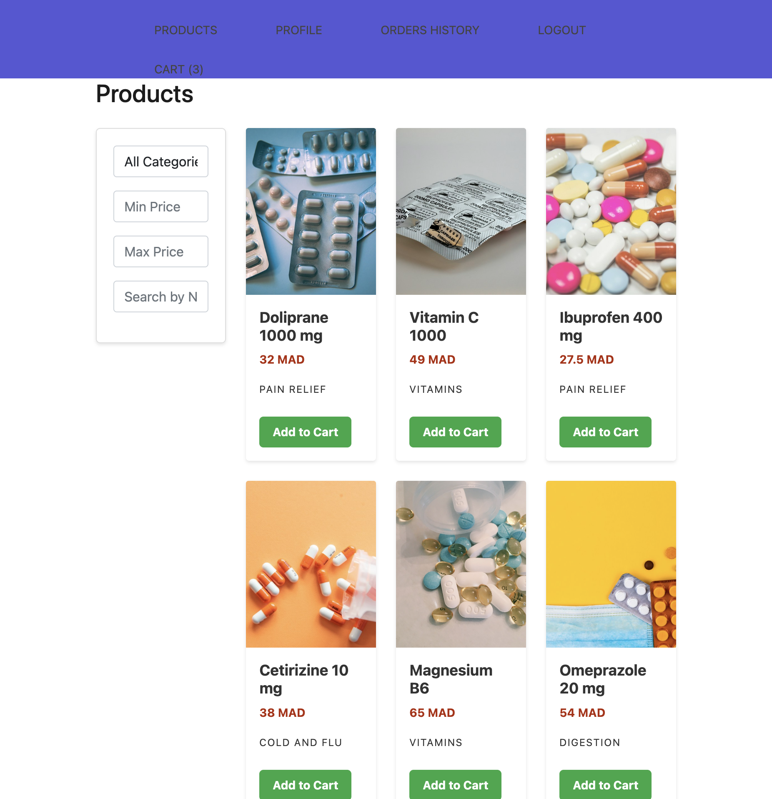
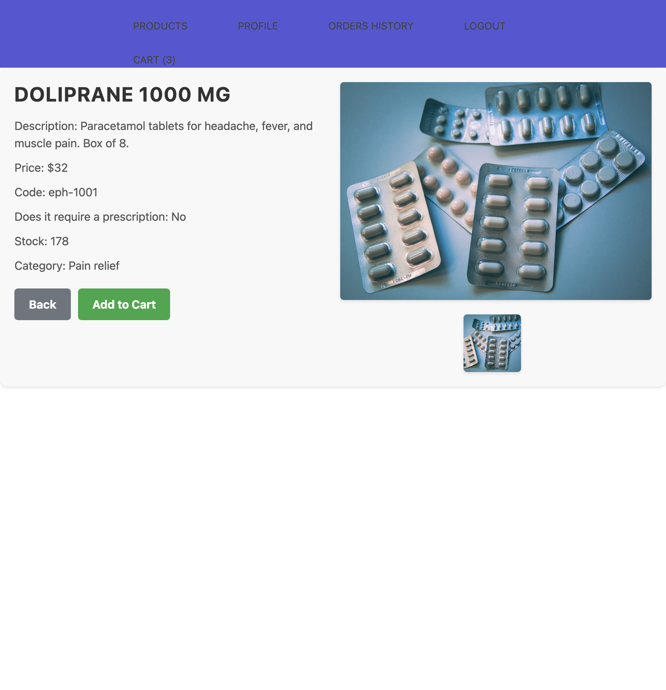
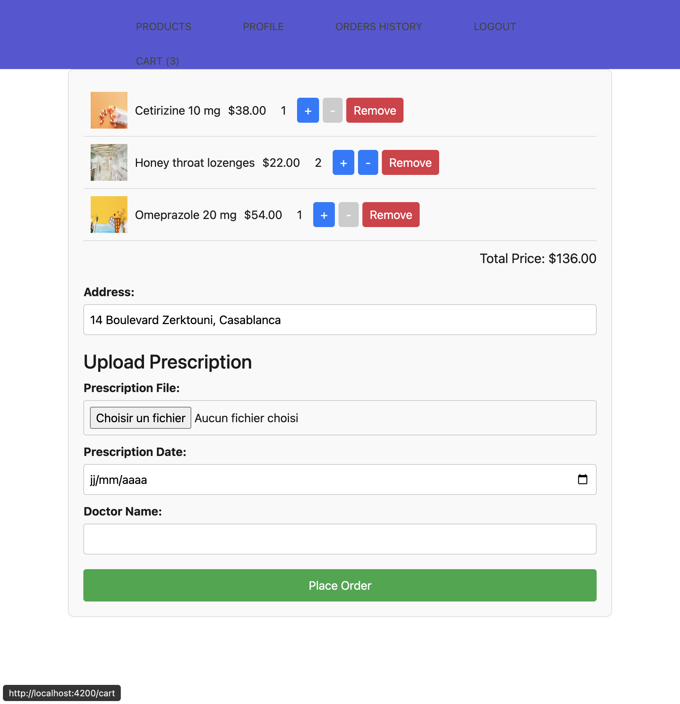
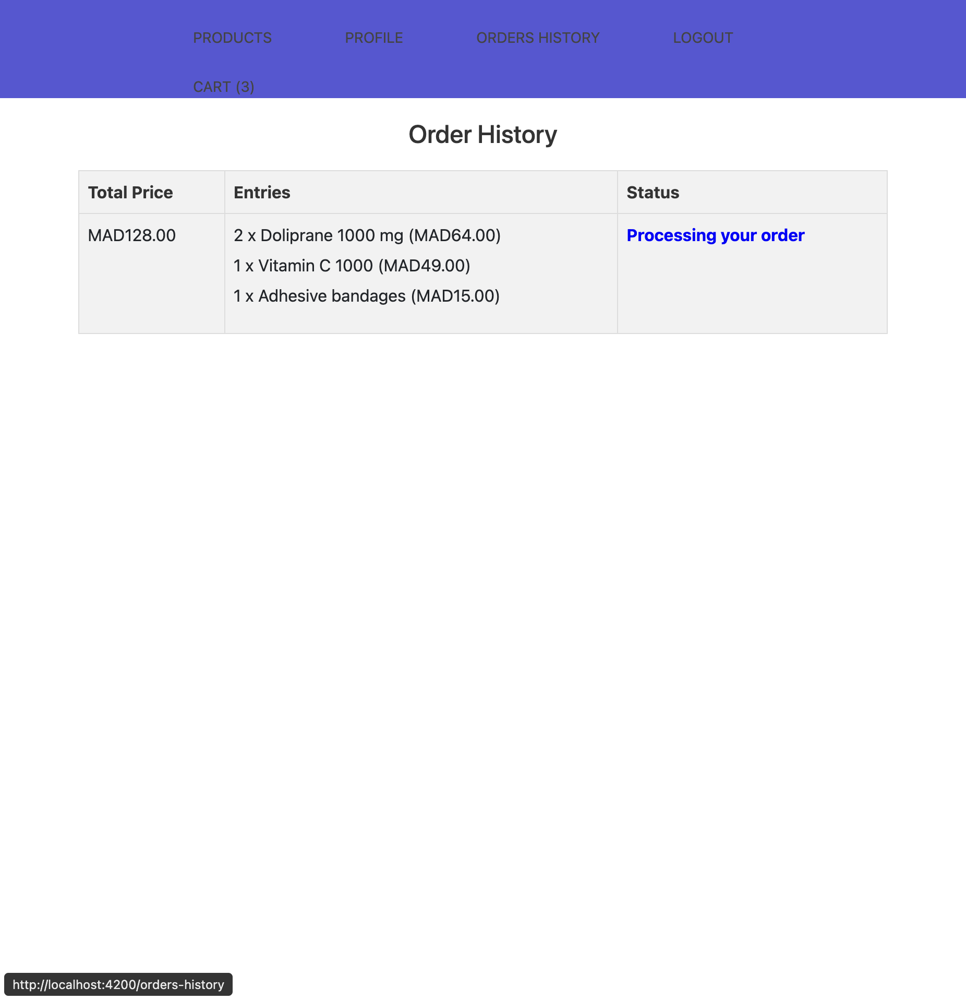
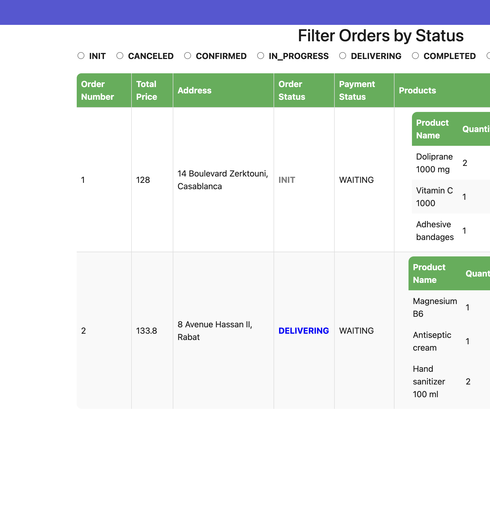
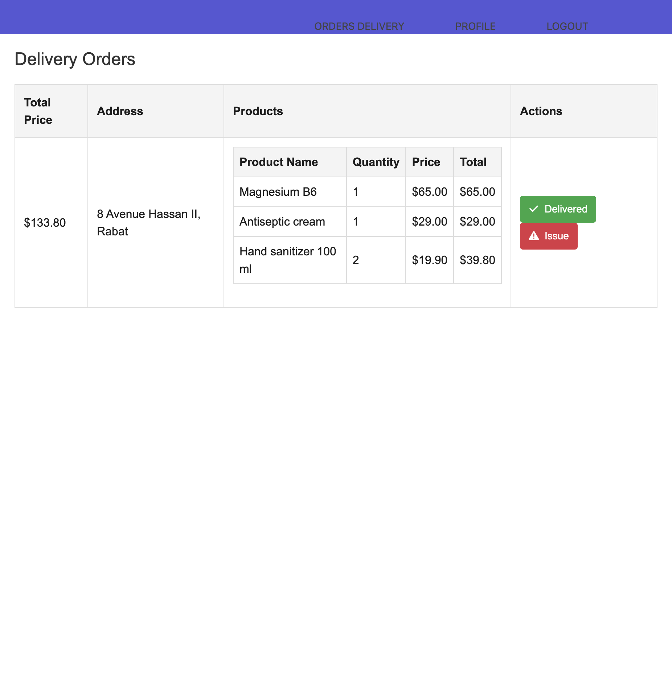
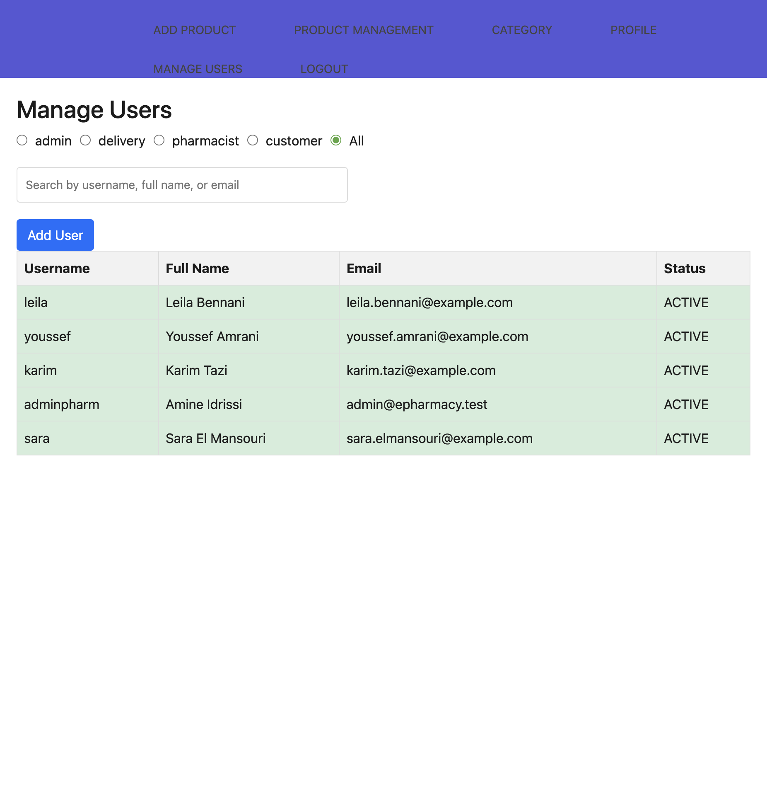
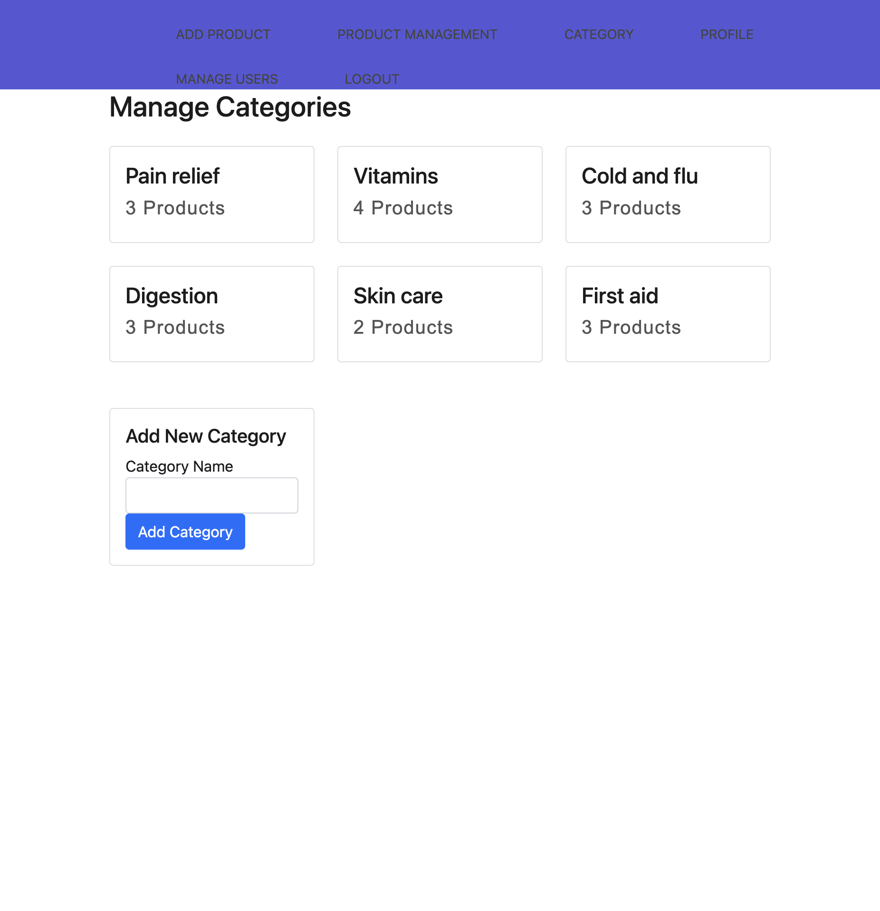
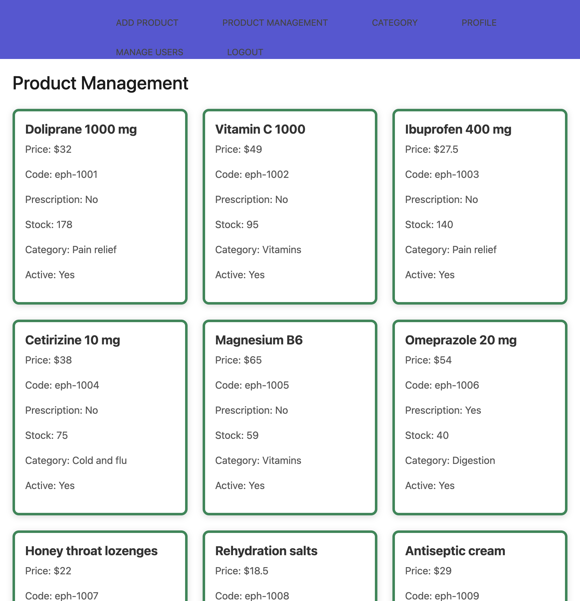

# E-Pharmacy

**A pharmacy shelf you can buy from: register, add a medicine, and send the order to a pharmacist.**


This is the Angular shop. The API is [E-Pharmacy](https://github.com/AbdelghaniElaoud/E-Pharmacy): Spring Boot, JWT, and MySQL. The public page shows the first three active products. Login sends a customer to the shelf, a pharmacist to the order queue, a rider to deliveries, and an admin to the user list.


```
landing  -->  register or login
                    |
                    v
customer: shelf --> product --> cart --> place order --> history
pharmacist: queue --> confirm or cancel, click a row for a PDF receipt
rider: deliveries --> Delivered or Issue
admin: users, categories, and the product list
```

## Why this exists

A medicine catalog that only lives in a database never shows the handoff. Someone has to pick the box, a pharmacist has to accept the order, and a rider has to mark it delivered. This shop puts that path on screen, from the landing cards through the cart and the two queues.

## Quick start

The page calls `http://localhost:8080`. Start the API first.

Java 17, Maven, and MySQL. The JDBC URL in the API's `src/main/resources/application.properties` is `jdbc:mysql://localhost:3306/epharmacy`, with `ddl-auto=update`. Put your own database user and password in that file. Order confirmation mail is in the same file. Do not commit those values if you change them.

`Initializer.java` uses text blocks, so the compiler source and target need to be 17. The `roles` table has to contain `ROLE_CUSTOMER`, `ROLE_DELIVERY_MAN`, `ROLE_ADMIN`, and `ROLE_PHARMACIST` before anyone can register. The seed that inserts them is commented out. `ReviewServiceTest` and `CartServiceTest` call `Customer.setRole`, which does not exist, so skip tests.

```bash
git clone https://github.com/AbdelghaniElaoud/E-Pharmacy.git && cd E-Pharmacy
mvn spring-boot:run -Dmaven.test.skip=true
```

Then the shop. Node and npm. Angular CLI 17.

```bash
git clone https://github.com/AbdelghaniElaoud/E-Pharmacy-front-end.git && cd E-Pharmacy-front-end
npm install && npx ng serve
```

Open http://localhost:4200. The home route is the landing page.

1. Register. The form asks for username, first name, last name, email, password, phone, and address, and the API stores an active customer plus an empty cart.
2. Sign in. A customer lands on **Products**.
3. Open a medicine, **Add to Cart**, set the address, and **Place Order**. The history line starts as **Processing your order**.

The pictures below are a catalog that was loaded for the screenshots (Doliprane 1000 mg at 32 MAD, Vitamin C, Ibuprofen, and the rest). A fresh database has no products until an admin adds them.

## What you get

- A landing page. **Login** and **Buy Medicines Now** both go to the sign-in screen. Under the story, the first three active products, each with a photo, a price in MAD, and **Buy Now**.


- Sign in on email and password. A wrong password returns `Invalid password`. An unknown email returns `User not found`. An inactive account returns `The account is inactivated please contact us`. **Forgot password?** sends a reset mail. **Register** is the customer form.


- A customer shelf. Filter by category, minimum price, maximum price, or name. The grid shows ten products. Each card links to the product and has **Add to Cart**. The header count is **Cart (n)**.



- A product page: description, price, code, whether a prescription is required, stock, and category. **Back** returns to the shelf. The price on this page is printed with a dollar sign. The cards on the shelf use MAD.



- A cart. Each line has a photo, a price, a quantity, and **Remove**. The address is required. If any line needs a prescription, the cart asks for a file, a date, and a doctor name, and the API refuses the order until that file is attached. **Place Order** assigns the first pharmacist and the first rider, lowers the stock, closes the cart, and opens a new one.



- Order history for that customer. Lines that are not `COMPLETED` stay on the list. `INIT` reads **Processing your order**. `CONFIRMED`, `IN_PROGRESS`, and `DELIVERING` read **On the way**. `CANCELED`, `ISSUE`, and `PRESCRIPTION_REFUSED` read **There is an issue, you will be contacted soon**.



- A pharmacist queue for the signed-in pharmacist. Filter by `INIT`, `CANCELED`, `CONFIRMED`, `IN_PROGRESS`, `DELIVERING`, `COMPLETED`, `ISSUE`, or `PRESCRIPTION_REFUSED`. Each row shows the address, the payment status, and the lines. The check confirms the order and emails the customer. The cross cancels it. **View Prescription** loads the file. Clicking the row downloads `Receipt_Order_<id>.pdf`.



- A rider queue. It hides orders that are still `INIT`, canceled, refused, flagged, or already completed. **Delivered** marks the order `COMPLETED` and the payment `PAID`. **Issue** flags it.



- An admin board: **Add Product**, **Product Management**, **Category**, **Manage Users**, **Profile**. Add Product asks for name, price, code, a prescription checkbox, description, stock, and a category, then opens the photo upload for that product. Product Management lists every product. A green border is on the shelf. A click flips `active`, which hides it from the public list. **Modify** edits the fields. **Delete** removes it. Categories show a name and a product count, and the form adds another. The user table lists people with **Add User**, and a click flips `ACTIVE` and `INACTIVE`.







- A profile for every role: name, email, status, and account age. Edit saves the name and email. A photo upload goes through the API.

## Make it yours

The shelf is `DashboardComponent`. The cart calls `http://localhost:8080/api/carts` and `api/orders`. Confirm and cancel live in `OrdersPharmacistComponent`. Fork it, point the API host at your own server, and open a pull request.

If you wanted the shelf, the cart, and the pharmacist on one path, [star the repo](https://github.com/AbdelghaniElaoud/E-Pharmacy-front-end). [Star history](https://star-history.com/#AbdelghaniElaoud/E-Pharmacy-front-end&Date).

The repository does not ship a license file yet.
